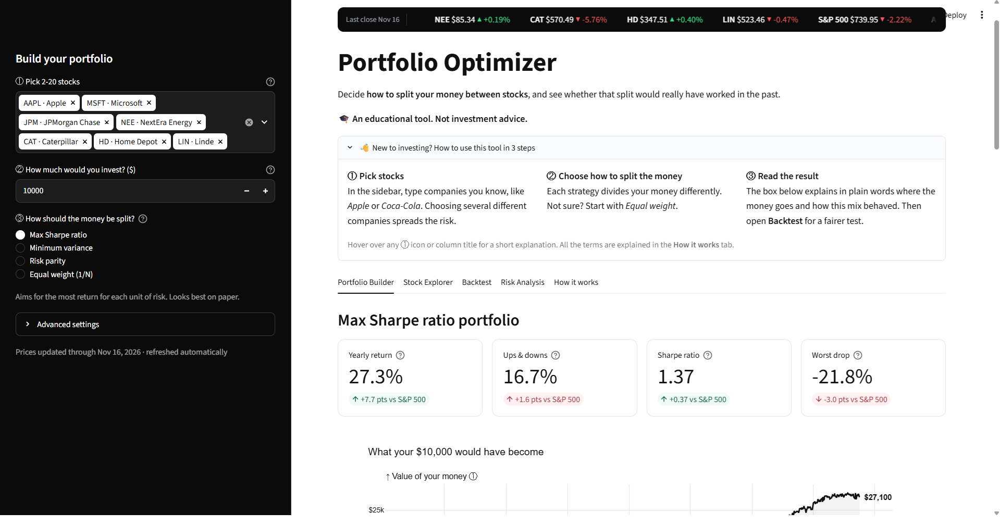

# Portfolio Optimizer

An end-to-end system that decides **how to split money between stocks** for the best return per unit of risk, and tests which allocation method actually holds up out of sample.

**Live demo: [smart-portfolio-split.streamlit.app](https://smart-portfolio-split.streamlit.app)**



Built with Python, SQL (SQLite), SciPy, scikit-learn and Streamlit, on real daily market data. The user picks 2 to 20 stocks from any US exchange; new stocks are downloaded once and saved. The dashboard is designed so that someone who has never invested can understand every number on the screen.

---

## Key finding

In a walk-forward backtest from February 2017 to November 2026 (monthly rebalancing, two-year estimation window, 10 bps transaction costs), the naive **equal-weight (1/N)** portfolio achieved the highest risk-adjusted return. **Max Sharpe** fell from a Sharpe ratio of 2.31 in sample to 0.93 out of sample.

| Strategy | CAGR | Volatility | Sharpe | Max drawdown | $1 grew to |
|---|---|---|---|---|---|
| Equal weight (1/N) | 19.7% | 16.2% | **1.04** | −32.1% | $5.79 |
| Risk parity | 17.8% | 15.2% | 0.99 | −31.0% | $4.95 |
| Max Sharpe | 19.9% | 18.6% | 0.93 | −27.1% | $5.86 |
| SPY (benchmark) | 14.9% | 18.2% | 0.72 | −33.7% | $3.89 |
| Minimum variance | 12.3% | 14.0% | 0.72 | −31.1% | $3.09 |

This reproduces a well-known result (DeMiguel, Garlappi & Uppal, 2009): optimized portfolios are highly sensitive to estimation errors in expected returns, and those errors often outweigh the benefit of optimization.

## What the system does

1. **Data pipeline** – pulls daily adjusted closing prices (yfinance) and the 3-month T-bill rate (FRED) into a normalized SQLite database. Updates are incremental, idempotent (`INSERT OR IGNORE` on a `(ticker, date)` key) and logged in a `pipeline_runs` table. The dashboard runs it automatically, so data stays current.
2. **Statistics engine** – estimates annualized expected returns and the covariance matrix, with optional Ledoit-Wolf shrinkage to reduce estimation noise.
3. **Optimizer** – solves a constrained quadratic problem (weights sum to 1, no short selling, max weight per stock) with SLSQP for four strategies: Max Sharpe, Minimum variance, Risk parity and Equal weight. Also traces the efficient frontier.
4. **Walk-forward backtest** – every month, re-estimates weights using only data available at that time, rebalances with transaction costs, and compares against SPY.
5. **Dashboard** – interactive Streamlit app: portfolio builder with the efficient frontier, stock explorer, backtest results, risk analysis (sector exposure, risk contributions, correlation heatmap), and an on-demand backtest of the user's own stocks.

## Built for new investors

The main audience is people who are just starting to invest, so the dashboard explains itself:

- **Three-step guide** at the top, and a sidebar that follows the same steps: pick stocks, enter an amount, choose how to split the money. Technical settings stay in a collapsed *Advanced settings* section.
- **Results in dollars and plain words.** A summary box says where each dollar goes, how much the mix gained, how much it swung and what the worst drop would have been.
- **Comparison with the S&P 500** under every metric (green = better than the index), plus a chart of what the money would have become next to the same money in the S&P 500.
- **All four strategies side by side** on the user's own stocks, with a short explanation of how they differ.
- **No silent surprises.** When a strategy gives a stock 0%, a message explains why (for example, it lost money in the period), and the stock still appears in the table.
- **Help where it's needed.** Metrics, table columns and the axes of the main charts have hover explanations, and a glossary covers the terms.
- **Honest framing.** In-sample numbers are labeled as hindsight, and the walk-forward backtest is presented as the fair test.

Design: a black-and-white theme with black menus, a live price strip with daily changes, charts that animate when they update, and a full-screen view with zoom and pan tools.

## Project structure

```
portfolio-optimizer/
├── app.py               # Streamlit dashboard
├── .streamlit/
│   └── config.toml      # theme: colors of the page and the sidebar
├── data/
│   ├── schema.sql       # database schema + stock universe
│   └── portfolio.db     # SQLite database (snapshot)
├── src/
│   ├── init_db.py       # creates the database
│   ├── pipeline.py      # ETL: download, transform, load
│   ├── stats.py         # returns, covariance, risk-free rate
│   ├── optimizer.py     # strategies + efficient frontier
│   ├── backtest.py      # walk-forward backtest
│   ├── universe.py      # list of US stocks + adding a new stock
│   └── theme.py         # colors and chart style
└── requirements.txt
```

## Run it locally

```bash
pip install -r requirements.txt
python src/init_db.py      # only needed for a fresh database
python src/pipeline.py     # download / update market data
python src/backtest.py     # run the backtest (about a minute)
streamlit run app.py
```

## Limitations

- **Survivorship bias:** stocks are picked from companies that exist today (the original study used 30 large companies chosen in 2026). Companies that failed along the way are missing, which flatters all strategies relative to SPY.
- **Expected returns are noisy:** historical means are weak forecasts, which is exactly what the backtest exposes.
- **Long-only, no leverage,** daily closing prices only.

For analysis and education only. Not investment advice.
